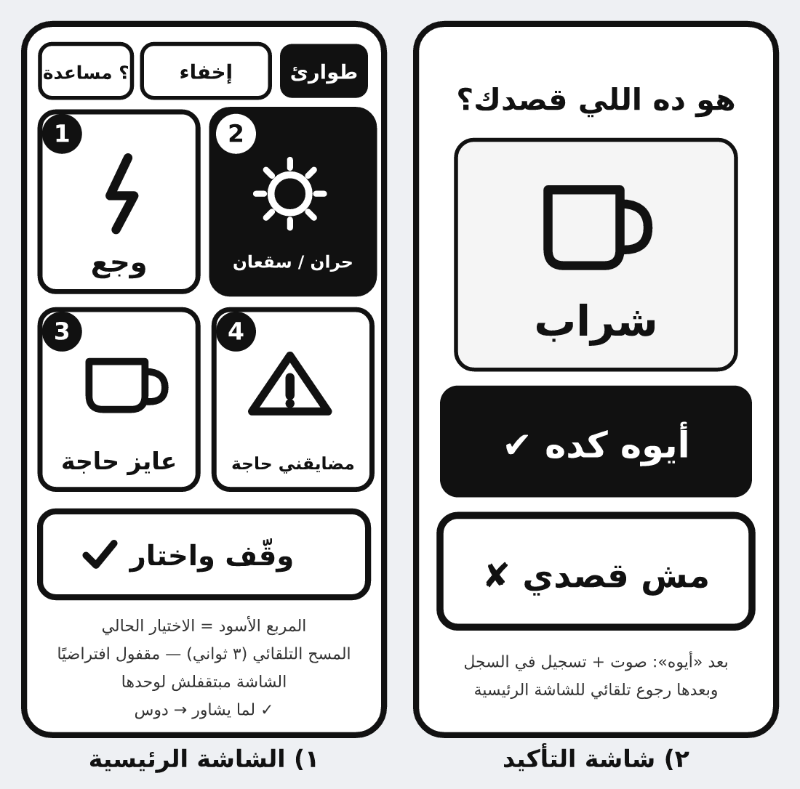

# «وسيلة» — الخطاب اللي بنتفق عليه

> **آخر تحديث:** 2026-11-04 · **الإصدار:** v0.1 (شغال فعليًا)
> المصدر: التسجيل + المرجع الشامل + القرارات المقفولة الستة (L1–L6) في الـ gist.

---

## 0. الخلاصة في ٦ سطور

1. **موقع صفحة واحدة** بتفتح من لينك، وتشتغل أوفلاين بعد أول تحميل.
2. **مربعات كبيرة**: أيقونة + رقم + كلمة. عددها في الشاشة **الأهل بيحددوه** (٢ / ٤ / ٦ / ٩ / تلقائي).
3. المريض **يومئ/يشاور** ← اللي ماسك التليفون يدوس ← **شاشة تأكيد** «أيوه / مش قصدي».
4. **بدون صوت** — بصري ١٠٠٪ (قرارك).
5. الأهل يضيفوا ويعدّلوا الأقسام بنفسهم من جوّه الموقع، والتصدير بيتحول لـ `data.js` على GitHub.
6. بعد التجربة الحقيقية → **WebView/APK** بنفس الكود بالحرف.

---

## 0.1 القرارات المقفولة (من إجاباتك — 2026-11-04)

| # | القرار | الحالة |
|---|---|---|
| C1 | ❌ **مفيش صوت** (لا TTS ولا تسجيل) — كله بصري | ✅ مقفول |
| C2 | **الأهل بيتحكموا في عدد المربعات** في الشاشة الواحدة، ويتظبط على أي مساحة | ✅ مقفول · متعمّل |
| C3 | **٦ أقسام** من أول نسخة | ✅ مقفول · متعمّل |
| C4 | النشر: **Cloudflare Pages** + GitHub Pages كاحتياطي (الكود بيشتغل من الاتنين) | ✅ مقفول |
| C5 | **ويب الأول**، WebView بعد التجربة | ✅ مقفول |
| C6 | ❌ مفيش أسماء/صور/تشخيص · مفيش تتبّع · `noindex` | ✅ مقفول |
| C7 | **مفيش اعتماد على «المسح الصوتي بيقف لوحده»** — التليفون مش حاسس بحركة الراس | ✅ متصحّح |
| C8 | **دعم صور** مش أيقونات بس — كل الصيغ، صور من الجهاز أو من مجلد `images/` | ✅ مقفول · متعمّل |

---

## 1. الشاشات



### الشاشة الرئيسية
| العنصر | التفصيل |
|---|---|
| مربعات كبيرة | أيقونة SVG + رقم (١–٤…) + الكلمة بخط ضخم — الحجم بيتحسب من حجم المربع نفسه، فمفيش مربع بيطلع صغير |
| الصور | لو الخيار له صورة بتظهر **كاملة من غير قص** (object-fit: contain) وبتاخد مكان الأيقونة |
| اللمس | دوسة على المربع = اختيار. لو المربع له فروع، بيفتح مستوى أعمق (ومعاه سهم صغير) |
| المساحة | `١ صف × ٢` أو `٢×٢` أو `٢×٣` أو `٣×٣` — بتتغير أوتوماتيك على حسب عدد المربعات واتجاه الشاشة |
| سهم الصفحات | لو الخيارات أكتر من العدد المختار → زرار «قبل / بعد» + نقط أرقام |
| شريط فوق | `؟ مساعدة` · `إخفاء فوري` · `طوارئ` |
| شريط تحت | `رجوع` (بيتنطفي في المستوى الأول) |
| علامة «تمريض» | على أي حاجة محتاجة موافقة (أكل/شرب/تنفس/حمام) |

### شاشة التأكيد
«هو ده اللي قصدك؟» + الأيقونة والكلمة بحجم أكبر + **أيوه كده ✓** / **مش قصدي ×**.
وبعد «أيوه» → شاشة «تمام» بترجع لوحدها بعد ١٠ ثواني.

### شاشات مساعدة
- **؟ مساعدة**: ٤ خطوات + تبديل الوضع الليلي/الأرقام + مدخل «وضع الأسرة».
- **إخفاء فوري**: شاشة بيضا فاضية بضغطة واحدة (زرار شبه مخفي في الركن عشان الرجوع).
- **طوارئ**: شاشة حمرا كبيرة **«نادي الممرض بسرعة»**.

### وضع الأسرة
- عدد المربعات · الأرقام · الوضع الليلي
- إضافة/تعديل/مسح: قسم · خيار · خيار جوّه خيار (أي عمق)
- اختيار أيقونة من ٣٥ أيقونة + علامة «محتاج تمريض»
- **صورة/كاميرا** كخانتين جوّه شبكة الأيقونات نفسها، أو مسار/رابط من `images/` — ضغط تلقائي + شبكة أمان ٣ ثواني + كسر كاش تلقائي
- **تنزيل data.js** (جاهز للرفع على GitHub) · نسخ · استيراد ملف
- إحصائية **«أكتر حاجة اتطلبت»** + مسح السجل

---

## 2. ليه «ويب» الأول وبعدين WebView

| السبب | الفايدة |
|---|---|
| مفيش متجر ولا مراجعة | لينك في ٥ دقايق، وأي تعديل بيوصل لكل الأسرة فورًا |
| أي جهاز | أندرويد قديم، آيفون، تابلت، لابتوب — نفس الملف |
| أوفلاين | Service Worker: بتفتح من غير نت (نت المستشفى ضعيف) |
| تعديل من الموبايل | الأهل يعدّلوا من GitHub من غير كمبيوتر |
| **WebView بعدين = نفس الكود** | `index.html` جوّه تطبيق أندرويد صغير → APK |

**نقطتين قبل ما تقرر:**
- **PWA** («إضافة للشاشة الرئيسية») بتديك تجربة تطبيق (أيقونة + ملء الشاشة + أوفلاين) **من غير WebView خالص**.
- ⚠️ **الصوت** (لو رجعنا له يوم): `speechSynthesis` **مش شغال** جوّه WebView على أندرويد، ومحتاج جسر JS للصوت الأصلي. حاليًا مفيش صوت، فالموضوع مش مطروح.

---

## 3. النطاق

### v0.1 — ✅ متعمّل (اللي قدامك دلوقتي)
- [x] صفحة واحدة RTL · تباين أسود/أبيض · بدون مكتبات ولا خطوط خارجية (~35KB كود)
- [x] مربعات بأيقونة + رقم + كلمة، وحجم بيتحسب من حجم المربع
- [x] مربعات بـ**صورة أو أيقونة** + رقم + كلمة، وحجم بيتحسب من حجم المربع
- [x] عدد المربعات: تلقائي / ٢ / ٤ / ٦ / ٩ + تعدّد الصفحات
- [x] تنقّل بأي عمق + رجوع + مسار فوق
- [x] شاشة تأكيد + «مش قصدي»
- [x] علامة «تمريض» (أكل · شرب · تنفس · حمام)
- [x] إخفاء فوري + طوارئ
- [x] كيبورد ١–٩ (زرار بلوتوث / لابتوب) و Esc للرجوع
- [x] **صور بكل الصيغ** (jpg · png · webp · gif · svg · avif · bmp · ico · heic · tiff …) من الجهاز أو من `images/`، بضغط تلقائي وبديل أيقونة لو الصيغة مش بتتعرض
- [x] الشاشة مبتقفلش (Wake Lock)
- [x] وضع الأسرة كامل + تصدير/استيراد JSON + إحصائية
- [x] المحتوى محفوظ بعد قفل المتصفح (localStorage) + `data.js` هو الأصل
- [x] PWA + أوفلاين (manifest + sw.js + أيقونات)

### v0.2 — بعد أول تجربة جانبه
- [ ] وضع **«سؤال واحد»**: مربع واحد ضخم بيتقلب بدل ٤
- [ ] **«مين/إيه»** بعد أي «مضايقني» (حل Q6) — موجود مبدئيًا كفرع تحت «حد ضايقني»
- [ ] ترتيب/سحب المربعات (drag) في وضع الأسرة
- [ ] مؤقت جلسة: بعد ١٠ دقايق «خلاص كفاية؟» (منع الإجهاد)
- [ ] صفحة طباعة الكارت الورقي الاحتياطي

### مستبعد نهائيًا
❌ صوت · ❌ أسماء أو صور شخصية · ❌ أي تحليلات أو تتبّع · ❌ AI جوّه التطبيق · ❌ حسابات ودخول · ❌ محتوى روحاني (L5)

---

## 4. الملفات (كلها موجودة دلوقتي)

```
/ha
├── index.html              ← الصفحة
├── styles.css              ← التباين العالي + RTL + الأحجام
├── app.js                  ← كل المنطق (بدون مكتبات)
├── icons.js                ← ٣٥ أيقونة SVG يدوية
├── data.js                 ← الأقسام  ←  مصدر الحقيقة (L6)
├── sw.js                   ← أوفلاين (شبكة الأول، كاش بديل)
├── manifest.webmanifest    ← PWA
├── icons/                  ← أيقونة التطبيق (svg + 192 + 512)
└── docs/
    ├── PLAN.md              ← الملف ده
    └── wireframe.png / .svg ← رسم الشاشات
```

**نشر:** Cloudflare Pages → Connect to Git → اختيار الريبو → Deploy → لينك + QR.
(نفس الملفات بتشتغل على GitHub Pages زي ما هي.)

---

## 5. اقتراحاتي — وحالتها

| # | الاقتراح | الحالة |
|---|---|---|
| S1 | تصحيح: المسح ما بيقفش لوحده — التحكم في إيد الكيرجيفر | ✅ اتعمل (مفيش مسح تلقائي أصلاً) |
| S2 | صوت بشري مسجَّل | ❌ ملغي بقرارك (C1) |
| S3 | حل Q6 «السبب»: مش محتاجين الاسم، محتاجين الاتجاه → «حد ضايقني» ← دكتور/ممرض/أهل/غريب | ✅ اتعمل |
| S4 | وضع «سؤال واحد» | ⏳ v0.2 |
| S5 | «مش قصدي» ظاهر جنب «أيوه» بنفس الحجم | ✅ اتعمل |
| S6 | مفيش Timer بيفوّت اختيار | ✅ اتعمل (بس فيه رجوع تلقائي من شاشة «تمام» — مش مؤثر) |
| S7 | تكبير/تصغير المربعات | ✅ اتعمل بشكل أحسن: الحجم بيتحسب من مساحة الشاشة + تحكم في العدد |
| S8 | الشاشة متقفلش (Wake Lock) | ✅ اتعمل |
| S9 | وضع ليلي عالي التباين | ✅ اتعمل |
| S10 | سجل + «أكتر حاجة اتطلبت» | ✅ اتعمل |
| S11 | كيبورد ١–٩ | ✅ اتعمل |
| S12 | ورقة تجربة ٣ محاولات + كارت ورقي | ⏳ بعد النشر |
| S13 | قاعدة «سؤال واحد في اليوم» في README | ⏳ |
| S14 | **صور حقيقية بدل الأيقونات** — المريض بيتعرف على الصورة أسرع بكتير من رمز مجرّد | ✅ اتعمل |

---

## 6. اللي محتاج إجابة من الأسرة (مش هخمّن)

| # | السؤال | ليه واقف عليه |
|---|---|---|
| Q-A | **حركة راسه/إيده الشمال واضحة ومتكررة؟** | عليه كل حاجة — لو مش واضحة، هنحتاج «إقصاء نعم/لا» |
| Q-B | **مين هيمسك التليفون عمليًا؟** | يحدد التدريب والكلام اللي على الشاشة |
| Q-C | **في نت في المستشفى؟** | أوفلاين متعمّل بالفعل — بس مهم نتأكد |
| Q-D | **فيه حد معاه بالليل؟** | وضع الليل والسطوع |
| Q-E | **الأسرة موافقة رسميًا؟** (الابن قال «كتر خيرك») | مفيش مشروع من غير موافقة |

---

## 7. الخطوات الجاية

| # | الخطوة | الوقت |
|---|---|---|
| 1 | تفتح المعاينة على تليفونه وتجربها بنفسك (٥ دقايق) | فورًا |
| 2 | نظبط الأقسام/الأيقونات على اللي شفته | نص ساعة |
| 3 | رفع على Cloudflare Pages + لينك + QR | نص يوم |
| 4 | تجربة جانبه ٣ مرات + ورقة قياس (كام ثانية؟ فهمنا؟) | ٣ أيام |
| 5 | تحويل WebView/APK لو احتجناه | نص يوم |

---

## 8. حدودي (مش هعملها من غير كلامك)

- مش هحط أي اسم أو صورة شخصية أو تشخيص، ولا أي تتبّع أو إرسال بيانات.
- الصور اللي بتتحط صور **أشياء** (كوباية، شراب، سرير…) — مش أشخاص.
- مش هضيف قسم من دماغي — الأقسام الستة موجودة، وأي زيادة بموافقتك.
- مش هبني ميزة «حلوة» قبل ما نتأكد إن الأساسي اتجرّب جانبه.

---

## 9. قرارات

| # | القرار | الحالة |
|---|---|---|
| D1 | الاسم «وسيلة» (بدائل: إشارة · أقولها · كلمة) | 🟡 مؤقت — يتغيّر بأمر واحد |
| D2 | ويب صفحة واحدة، بدون إطار عمل ولا build | ✅ |
| D3 | Cloudflare Pages + GitHub Pages احتياطي | ✅ |
| D4 | PWA + أوفلاين من أول يوم | ✅ متعمّل |
| D5 | مفيش مسح تلقائي افتراضيًا | ✅ |
| D6 | ٦ أقسام: وجع · حران/سقعان · أكل وشرب · تنفس · حمام · مضايقني حاجة | ✅ متعمّل |
| D7 | WebView بعد التجربة | ✅ |
| D8 | مفيش صوت | ✅ مقفول |
